# explorerepo

<p align="center"></p>

explorerepo lets an AI agent read or search a remote git repository without cloning it and without
the GitHub API. Install one Go binary and add a line to your global `AGENTS.md` (or `CLAUDE.md`),
and an agent that needs a single file stops cloning the whole repo. It runs `ls`, `cat`, `head`,
`tail`, `grep`, and `find` against the remote tree, over SSH or plain HTTPS.

```sh
go install github.com/autowert66/explorerepo/cmd/explorerepo@latest
```

Add this line to `AGENTS.md` or `CLAUDE.md`:

```markdown
To read or search the source of any remote git repo (a library, a dependency, a tool you are asked about), run `explorerepo --repo ORG/REPO -c '<script>'` in your shell (it is a CLI, not an MCP tool) instead of cloning, fetching raw GitHub URLs, `gh api`, or answering from memory; it is a read-only shell over the default branch (ls, tree, cat, head, sed -n, grep -A/-B/-C, rg, find, wc, sort, pipes, loops; no awk). Each call costs a network round trip, so aim for 2-3 calls: (1) orient and locate in one script, e.g. `-c 'tree -L 2 -d; echo "## hits"; grep -rn -m 30 "KEYWORD" src --include="*.rs"'`; (2) read every relevant range at once, e.g. `-c 'sed -n "40,120p" src/a.rs; echo "## b.rs"; grep -n -A 25 "fn name" src/b.rs'`; then answer. Prefer `grep -n -A N` and `sed -n` ranges over `cat` of whole files. `--repo` also takes gitlab.com/GROUP/REPO, gist:ID, any git URL, and `--rev TAG`; `explorerepo help` lists everything.
```

`explorerepo help agents` prints the same line, so `explorerepo help agents >> ~/.claude/CLAUDE.md` works too.

In a benchmark of opencode with DeepSeek V4.1 Flash (6 questions about real repos, 36 runs, each in a fresh
container with web search and webfetch available), installing explorerepo and this line cut tool calls by 57%,
tokens by 71%, and time to answer by 66%, with every answer correct either way. Per-run tool breakdowns are in
[`docs/BENCHMARK.md`](docs/BENCHMARK.md); the harness in `bench/` reruns it.

Then agents work in place:

```sh
explorerepo --repo octocat/Hello-World -c 'ls -la; head -20 README'
explorerepo --repo github.com/torvalds/linux --rev v6.11 -c 'grep -rn "sched_tick" kernel/sched | head'
explorerepo --repo torvalds/linux ls kernel
explorerepo --repo torvalds/linux pull drivers/gpu/drm/i915 ./i915
```

## Requirements

- To install: Go 1.21 or newer. If your toolchain is older than the version in `go.mod`, `go install`
  downloads it automatically.
- To reach a remote host: the system `ssh` with a key that can reach the host, or nothing at all
  for a public repository; explorerepo falls back to anonymous HTTPS when ssh is unavailable.
- For local repositories and the test suite: `git`.

The protocol probes recorded in `docs/PROBES.md` were run against GitHub and local git 2.56.0.

## Install

`go install` writes the binary to `$GOBIN` (default `$(go env GOPATH)/bin`). If `explorerepo` is not
found afterwards, add that directory to your `PATH`. To uninstall, delete the file. From a checkout,
`make build` writes it to `bin/explorerepo` instead.

## First run

```sh
explorerepo --repo octocat/Hello-World -c 'ls -la; head -5 README'
```

On success you get the repository listing and the file contents:

```
drwxr-xr-x - .
drwxr-xr-x - ..
-rw-r--r-- ? README
Hello World!
```

`ls -l` prints `?` for the size of a blob that has not been fetched yet; the size appears after the
file has been read once.

## Usage

```
explorerepo --repo SPEC [--rev REV] [options] -c 'SCRIPT'
explorerepo --repo SPEC [--rev REV] [options] CMD [ARGS...]     # single builtin, no shell parsing
explorerepo --repo SPEC [--rev REV] [options] < script.sh
explorerepo help [CMD | flags | repos | agents | about]
explorerepo --help [TOPIC]                                     # same as `help`, brief without a topic
explorerepo --version

options: --rev (alias --hash)  --refresh  --no-cache  --no-mux  --https  --no-https  --check
         --max-output BYTES (200K)  --max-fetch BYTES (256M)  --max-files N (20000)  --timeout DUR (60s)
         --color auto|always|never (auto)
env:     EXPLOREREPO_REPO (default --repo)  EXPLOREREPO_CACHE  EXPLOREREPO_DEBUG=1  EXPLOREREPO_QUIET  NO_COLOR
```

At a terminal, output is colored; pipes, redirects and known agent harnesses get plain text.
`--color`, `NO_COLOR`, `FORCE_COLOR` and `CLICOLOR_FORCE` override that (`explorerepo help flags`
has the details).

`SPEC` accepts `owner/repo` (GitHub), `github.com/owner/repo`, `gitlab.com/group/sub/repo`,
a gist (`gist:<id>`, `gist.github.com/<id>`, or a pasted `https://gist.github.com/<user>/<id>`
URL), `https://host/owner/repo`, `git@host:path.git`, `ssh://user@host[:port]/path`,
`file:///abs/path`, or a local path.
Tested hosts: GitHub and gists, GitLab, Bitbucket, Codeberg/Forgejo/Gitea, and googlesource.com; any
server speaking Git protocol v2 with filtered fetch works. Servers without filter support (git.sr.ht,
git.kernel.org, savannah) are refused with an error. `explorerepo help repos` prints all of this.
To test another host, run `explorerepo --repo SPEC --check`: it tries ssh and HTTPS separately,
without the cache or the fallback, and reports each step (connect with protocol v2 and filter
support, refs, commit, one tree, a subtree in one request, a blob) and a verdict.

It exits 0 when at least one transport works and 128 otherwise. `--https` or `--no-https` limits it
to one transport.
`--rev` accepts a branch, tag (annotated tags are peeled), a `refs/...` name, or a full 40-hex
OID; a tag wins over a branch with the same name, as in git. Abbreviated OIDs are rejected. The
byte flags accept `K`, `M`, and `G` suffixes.

Gists are ordinary git repositories, so everything below works on them unchanged. They live on the
separate host `gist.github.com`, so a `Host github.com` block in `~/.ssh/config` (keys, identity
files) does not apply. Add a matching `Host gist.github.com` stanza if you rely on one. A public gist
is also readable over the anonymous HTTPS fallback; a secret gist needs an SSH key (or a token) that
has access.

There is no config file. `--repo` (or `EXPLOREREPO_REPO`) is the only required setting; everything
else has the default shown above.

### Transports

SSH is tried first. If a session cannot be established (no key, port 22 blocked, `ssh` not
installed), explorerepo retries the same host over anonymous HTTPS (Git smart HTTP v2, still no
GitHub API). The object cache is shared between the two, so nothing is re-fetched once a key is set
up. Anonymous HTTPS reads **public** repositories only; private ones need ssh. When the fallback is
used, a hint is printed to stderr at most once per day (recorded in the cache dir); suppress it with
`EXPLOREREPO_QUIET`, or skip the fallback entirely with `--no-https`. `--https` forces HTTPS.
`--no-cache` also suppresses the note, since there is nowhere to record the timestamp.

The exit status is the script's. Setup errors (auth, repository not found, bad revision) print
`explorerepo: ...` and exit 128. A missing `--repo` exits 2 (usage error). An unknown command exits
127, a timeout exits 124, and an internal error exits 70. Output beyond `--max-output` is cut off
with a notice on stderr; truncation is not an error.

### pull

`pull [-f] PATH [DEST]` is the only command that writes to the real disk. It copies a file or
directory to `DEST` (default `./<basename of PATH>`), refusing to overwrite without `-f` and refusing
`.git` entries and symlink escapes. Use it when you want real tools (`rg`, `cargo`, ...) on a
subtree.

## Cache and cleanup

Fetched objects and refs are cached under `$EXPLOREREPO_CACHE`, or
`os.UserCacheDir()/explorerepo` when that is unset (on macOS, `~/Library/Caches/explorerepo`).
Objects are stored as git loose objects, so you can read them with
`GIT_OBJECT_DIRECTORY=<cache>/objects git cat-file -p <oid>`. Refs are cached for 10 minutes so an
agent sees a consistent snapshot across calls; `--refresh` bypasses the ref cache, and `--no-cache`
keeps everything in memory. To reset, delete that directory. The only other thing written is the ssh
control socket under `$TMPDIR/explorerepo-<uid>/`, which goes away when the master idles out.

## Development

```sh
make test                         # offline: builds throwaway repos with the git CLI, uses the local transport
make race
make live                         # EXPLOREREPO_LIVE=1: octocat/Hello-World and golang/go over ssh
scripts/probe.sh ssh octocat/Hello-World.git
```

## Out of scope

SHA-256 repositories; protocol v0 servers; authenticated HTTP (the anonymous HTTPS fallback reads
public repositories only); Git LFS content (pointer files are shown as-is); `refs/replace/*`
replacements (git applies them locally, but the server sends the real objects); path-limited `log`;
a background daemon; FUSE/NFS mounts; writing or pushing anything; process substitution, background
jobs, and real program execution inside the shell.
